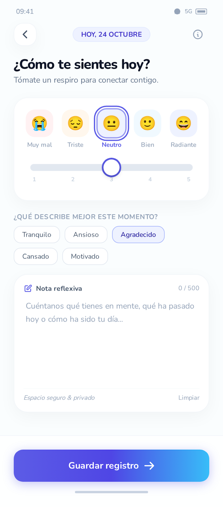
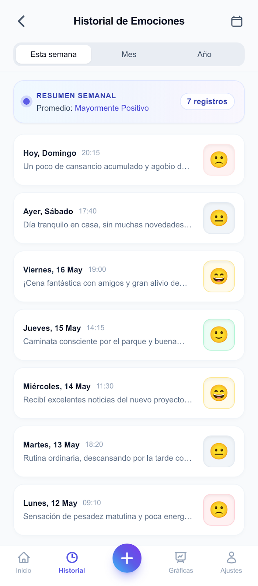
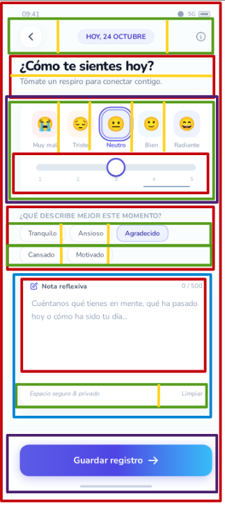
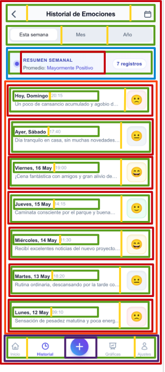

# 03. Estudio de los componentes 
Varias zonas de los mockups corresponden a datos dinámicos que provienen de una lista o colección. En Compose, estos elementos se definen una sola vez dentro de un ítem y se repiten automáticamente

 
 
 
 ## Componentes que se repiten
 ### Tarjeta de emociones 
 

Cinco estados de ánimo representados por un emoji sobre un fondo de color suave con su respectivo texto debajo, teniendo uno de ellos un borde resaltado como activo. Es un mismo patrón visual repetido en horizontal que se resuelve iterando una colección de datos sobre una Row.

### Etiquetas de selección

Cinco botones interactivos con esquinas redondeadas donde el usuario selecciona una etiqueta que cambia su color de fondo y de texto al estar activa. Al variar la longitud del texto, se organizan dentro de un contenedor FlowRow para que salten de línea automáticamente.

### Fila de registro de historial 

Tarjeta de registro diario con fecha, hora, nota de texto y emoji de estado.
Se repite siete veces en la pantalla de "Historial de Emociones" (Hoy, Ayer, Viernes...). Muestra la fecha y hora arriba a la izquierda, una vista previa de la nota reflexiva debajo, y el emoji correspondiente al estado de ánimo en un recuadro redondeado a la derecha. Es el elemento típico que se renderiza dentro de una LazyColumn.

## Componentes que aparecen una sola vez
Estas piezas son fijas, actúan como contenedores únicos o controles globales y forman el armazón estructural de cada pantalla.

### Tarjeta Horizontal. App Bar

Barra con un boton de retroceso, fecha con estilo de capsula y un icono de informacion. Ocupa el espacio topBar / Row de esta pantalla.

### Historial de Emociones

Incluye la navegación hacia atrás, el título central estático y un icono de agenda/calendario a la derecha. Se resuelve con el hueco topBar de un Scaffold mediante un TopAppBar.

### Fila de pestañas fijas: Esta semana, Mes, Año

Un control horizontal superior con tres opciones fijas para filtrar el histórico, donde la opción activa ("Esta semana") queda resaltada con un fondo blanco. Se maqueta de forma estática usando una TabRow o una Row con botones de opción.

### Barra de navegación inferior

Ocupa el hueco bottomBar del Scaffold. Muestra los cuatro accesos fijos de la app y un botón de acción flotante central (FloatingActionButton) con un icono de más (+) sobre un fondo degradado morado para registrar una nueva emoción.

# Estructura en layot

 